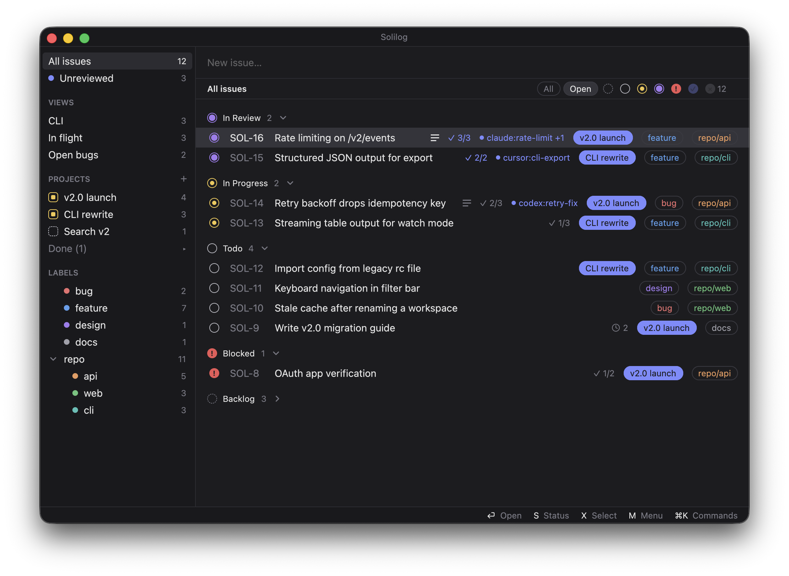

# Solilog

A fast, minimal, offline issue tracker for one. Native desktop app built in Rust with [GPUI](https://gpui.rs), plus a CLI that works on the same data (handy for scripts and AI agents).



## Install (macOS)

```sh
make install      # builds Solilog.app, installs it in /Applications,
                  # links the `solilog` command into ~/.local/bin
make uninstall    # removes both; your database is kept
```

`APP_DIR=…` and `BIN_DIR=…` change where they go. `make` lists the other targets (tests, lints, bundle only, …).

## Run from source

```sh
cargo run                       # desktop app
cargo run -- --help             # CLI
cargo run -- issue create "Fix the thing"
cargo run -- issue ls --open --json
cargo run -- issue set-status SOL-1 done
pbpaste | cargo run -- issue edit SOL-1 -d -   # description from stdin
cargo run -- checklist add SOL-1 "Write tests" "Update docs"
cargo run -- checklist check 1            # item ids are shown by `issue show`
cargo run -- attachment add SOL-1 crash.log  # copied next to the database
cargo run -- issue create "Crash on load" -l acme/reverb -l bug
cargo run -- issue ls -l acme             # also matches sublabels like acme/reverb
cargo run -- label ls
cargo run -- project create "Reverb v1.1" -l acme/reverb
cargo run -- issue create "Preset crash" -p "reverb v1.1"   # gets acme/reverb too
cargo run -- issue ls -l acme --no-project                 # work outside any project
cargo run -- view save "Acme bugs" --open -l acme -l bug   # saved filter
cargo run -- issue ls --view "acme bugs"
```

## Keyboard

Everything is a command. Press `cmd-k` to open the command palette (`cmd` here is `ctrl` on Linux). The sidebar (`cmd-b`, `h` to focus it) lists saved views, projects and labels; right-click a row (or press `m`) for its menu: rename, delete, set status. Issues have one too (status, labels, projects, archive, delete); Enter (or a double click) opens an issue to edit its title, description and checklist, saved as you type, and Escape goes back (in the checklist: `a` adds an item, Enter goes to the next one, `cmd-enter` checks it, `alt-up`/`alt-down` (or dragging its handle) move it, and emptying an item deletes it; drop files on an open issue, or paste them (`cmd-v`, also screenshots), to attach them; click an image to preview it (left/right for the issue's other images, `r` to show it in the file manager) or another file to show it in the file manager); done and cancelled issues are hidden at first: the buttons at the top right of the list toggle "Open" and each status, and "All" (`f a`) shows every status; `f` then a key edits the current filter (`f l` label, `f p` project, `f s` status, `f o` open only, `f c` clear), and `cmd-s` saves it as a view. Key bindings are customizable in `~/.config/solilog/keymap.json` (run the "Workspace: Open Keymap" command); `solilog keymap defaults` prints the defaults.
